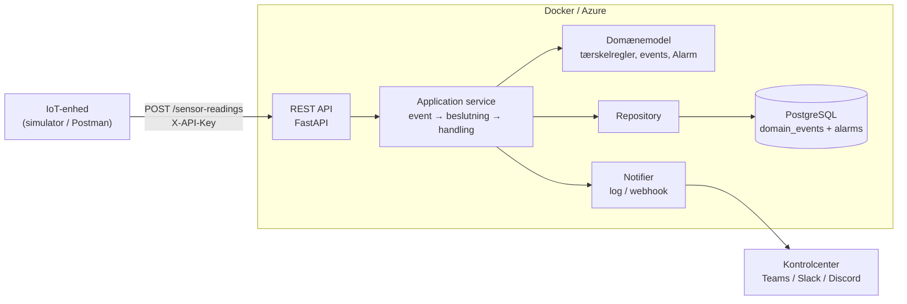
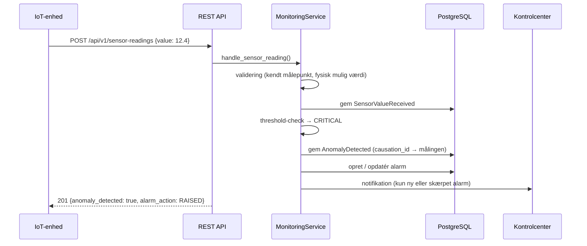
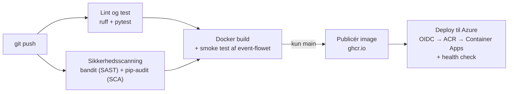
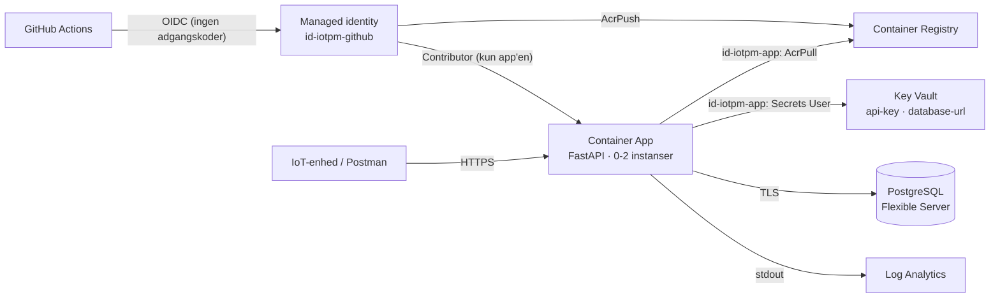

# Asset Condition Monitoring – Predictive Maintenance MVP

Teknisk MVP for **Intelligent IoT Solutions A/S** (KEA 6. semester, fag 6.2, afleveringsopgave #2).
Et REST API modtager sensormålinger fra IoT-enheder på vindmøller, vurderer dem mod forretningsregler
og opretter alarmer til kontrolcentret, når en komponent er på vej mod nedbrud.

## Domænekobling

Løsningen realiserer bounded context'en **Asset Condition Monitoring**, som i delopgave 1 blev
klassificeret som virksomhedens eneste **core subdomain**. Den understøtter value streamen
*Prevent B2B Asset Failure* og løser hotspottet fra Event Storming: afvigelser opdages i dag
manuelt i Power BI.

| Event Storming-begreb | I koden |
|---|---|
| Domain event: *Sensor Value Received* | `EventType.SENSOR_VALUE_RECEIVED` |
| Beslutning: *Threshold-check* | `ThresholdRule.classify()` |
| Domain event: *Anomaly Detected* | `EventType.ANOMALY_DETECTED` |
| Handling: *alarm / notifikation* | `Alarm`-aggregatet og `Notifier` |
| Asset (kundens anlæg) ≠ IoT Device (sensoren) | `asset_id` og `device_id` |

## Arkitektur



Koden følger **ports & adapters**: domænemodellen (`app/domain.py`) er ren Python uden afhængighed
af web-framework eller database. API, database og notifikation er adaptere, der kan udskiftes.



### Forretningsregler

| Målepunkt | Enhed | WARNING | CRITICAL | Retning |
|---|---|---|---|---|
| `gearbox_vibration` | mm/s | ≥ 7,1 | ≥ 11,0 | over |
| `bearing_temperature` | °C | ≥ 80 | ≥ 95 | over |
| `oil_pressure` | bar | ≤ 1,5 | ≤ 1,0 | under |

* **Fysisk umulige værdier** (fx 500 mm/s) afvises med `422` som mulig sensorfejl og gemmes ikke.
* **Højst én åben alarm pr. anlæg og målepunkt.** Gentagne anomalier tælles op på den åbne alarm
  i stedet for at oversvømme kontrolcentret. Kun nye og **skærpede** alarmer (WARNING → CRITICAL) notificeres.
* En operatør **kvitterer** for en alarm. Herefter giver en ny anomali en ny alarm.

## Kom i gang

Kræver [Docker Desktop](https://www.docker.com/products/docker-desktop/).

```bash
git clone <repo-url>
cd iot-predictive-maintenance
docker compose up -d --build
```

| Hvad | Adresse |
|---|---|
| Swagger (interaktiv API-dokumentation) | http://localhost:8000/docs |
| Health check | http://localhost:8000/health |
| Adminer (se databasen) | http://localhost:8080 – System: *PostgreSQL*, Server: `db`, Bruger: `iot`, Adgangskode: `iot-local-password`, Database: `iot_monitoring` |

API-nøglen er `local-dev-key`, medmindre andet er sat i `.env` (se `.env.example`).

### Send målinger fra en anden computer (IoT-enhed)

Simulatoren kræver kun Python, ingen pakker:

```bash
python device_simulator/simulate.py --url http://<ip-på-serveren>:8000 --scenario degrading
```

Scenariet `degrading` simulerer en gearkasse, der slides gradvist: normal → WARNING → CRITICAL.
Find serverens IP med `ipconfig`, og tillad port 8000 i Windows Firewall på serveren.

### Postman

Importér `postman/IoT-Predictive-Maintenance.postman_collection.json` og kør mapperne i rækkefølge.
Ret variablen `baseUrl`, hvis API'et kører på en anden maskine.

### Kør uden Docker (udvikling)

```bash
python -m venv .venv
.venv\Scripts\activate          # Windows  (Linux/macOS: source .venv/bin/activate)
pip install -r requirements-dev.txt
set API_KEY=local-dev-key        # Linux/macOS: export API_KEY=local-dev-key
uvicorn app.main:create_app --factory --reload
```

Uden `DATABASE_URL` bruges en lokal SQLite-fil.

## API

| Metode | Endpoint | Formål |
|---|---|---|
| `POST` | `/api/v1/sensor-readings` | Modtag måling → events → evt. alarm |
| `GET` | `/api/v1/alarms` | List alarmer (filter: `status`, `asset_id`) |
| `GET` | `/api/v1/alarms/{id}` | Hent én alarm |
| `POST` | `/api/v1/alarms/{id}/acknowledge` | Kvittér for alarm |
| `GET` | `/api/v1/events` | List domain events (filter: `event_type`, `asset_id`) |
| `GET` | `/api/v1/thresholds` | List tærskelregler |
| `GET` | `/health` | Health check (uden nøgle) |

Alle `/api/v1`-endpoints kræver headeren `X-API-Key`.

## Test

```bash
pytest --cov=app
```

* `tests/test_domain.py` – unit tests af forretningsreglerne (uden database)
* `tests/test_api.py` – integrationstests af hele flowet gennem API'et til databasen
* `tests/test_notifier.py` – notifikation, herunder at en fejlende webhook ikke vælter modtagelsen

## CI/CD (GitHub Actions)

`.github/workflows/ci-cd.yml` kører ved hvert push og pull request:



Pull requests kører test, sikkerhedsscanning og smoke test, men deployer ikke. Kun `main` deployes.
Det image, der deployes, er præcis det, der blev testet (build once, deploy many).
Dependabot (`.github/dependabot.yml`) foreslår ugentligt opdateringer af afhængigheder, actions og base-image.

## Drift i Azure

Infrastrukturen er beskrevet som kode i `infra/main.bicep` og udrulles med `infra/deploy.ps1`.



| Ressource | Formål |
|---|---|
| Container Apps | Kører API'et serverless med HTTPS, health probes og autoskalering |
| PostgreSQL Flexible Server (B1ms) | Separat database for domain events og alarmer, kun TLS |
| Key Vault | API-nøgle og database-forbindelse. Appen henter dem via sin managed identity |
| Container Registry | Private images. Kun adgang via Entra ID-identiteter (admin-bruger slået fra) |
| Log Analytics | Samler appens JSON-logs til søgning og overvågning |
| Managed identities | `id-iotpm-app` (læse image og secrets) og `id-iotpm-github` (deploy). Least privilege |

```powershell
az login
./infra/deploy.ps1 -Location francecentral     # første gang ca. 10-15 min
az keyvault secret show --vault-name <kv-navn> --name api-key --query value -o tsv   # hent API-nøglen
```

Abonnementet (Azure for Students) tillader kun swedencentral, polandcentral, francecentral, germanywestcentral og austriaeast,
og PostgreSQL B1ms afvises i swedencentral og polandcentral. Derfor kører løsningen i **francecentral**.
Skoletenanten kræver MFA for at oprette ressourcer via CLI (`az login --claims-challenge ...`, som CLI'en selv foreslår).
Slet alt igen med `az group delete -n rg-iot-predictive-maintenance`.

## Sikkerhed og privacy by design

Defense in depth, lag for lag:

| Lag | Kontrol |
|---|---|
| Identitet og adgang | API-nøgle (`X-API-Key`) på alle forretnings-endpoints, sammenlignet i konstant tid. Nøglen ligger i en miljøvariabel, aldrig i koden |
| Netværk | Databasen er ikke udstillet uden for Docker-netværket. Containeren kører som ikke-root-bruger |
| Applikation og API | Inputvalidering af id'er, målepunkter og værdier (afviser `NaN`, `Infinity`, `<script>` og injection-forsøg). Alle SQL-forespørgsler er parametriserede via SQLAlchemy. Rate limiting (standard 120 kald/min pr. klient → `429` med `Retry-After`), også på forkerte nøgler mod brute force |
| Data | Telemetri fra vindmøller er ikke personoplysninger. Ved kvittering gemmes et medarbejder-id (`OP-117`), ikke et navn (GDPR art. 5, dataminimering) |
| Logning og audit | Hvert kald logges som JSON med tid, klient-IP, endpoint, statuskode og varighed. Afviste nøgler og rate limit-brud logges som `WARNING`. API-nøgler logges aldrig |
| Fejl sikkert | Global exception handler: klienten får en generisk besked og et `request_id`. Detaljerne står kun i loggen |
| Pipeline (shift-left) | SAST (bandit), SCA (pip-audit) og Dependabot. Secrets aldrig i repo (`.env` er i `.gitignore`) |

## Projektstruktur

```
app/
  domain.py         domænemodel: målinger, tærskelregler, events, Alarm-aggregat
  service.py        application service: event → beslutning → handling
  persistence.py    PostgreSQL/SQLite via SQLAlchemy: event store + alarmer
  api.py            REST-endpoints
  schemas.py        API-kontrakt (bliver til Swagger)
  notifier.py       notifikation via log og webhook
  security.py       API-nøgle
  logging_setup.py  struktureret JSON-logging
  main.py           opstart, health check, fejlhåndtering
device_simulator/   IoT-enhed (kun standardbibliotek)
postman/            Postman-collection til demo
tests/
```
